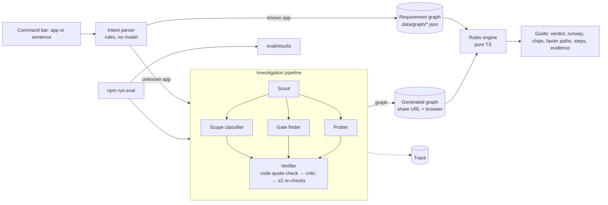

# Architecture

ChatGPT writes an answer. Greenlight works one out: the plan is computed by code from facts that each carry a source and a quote. Models only help find and classify those facts, and code checks their work.

| Piece | Where | Model? |
|---|---|---|
| Intent parser | `lib/intent.ts` | No |
| Requirement graph | `data/graph/*.json`, schema in `lib/graph/schema.ts` | No (curated) / yes (generated) |
| Rules engine | `lib/engine.ts` (+ scheduling in `lib/plan.ts`) | No |
| Retrieval | `lib/retrieval.ts`, `lib/probe.ts` | No |
| Pipeline | `lib/pipeline/run.ts` | Yes, 3–6 JSON calls |
| Verifier quote check | `lib/quote.ts` | No |
| Provider layer | `lib/llm.ts` | — |
| Harness | `scripts/eval.ts` | Yes (or mock) |

No database. Curated graphs are versioned JSON in the repo. Generated graphs live in the share URL (`#g=`, compressed), the visitor's browser and the server instance's memory. Traces live in the browser, instance memory and, for harness runs, `public/traces/`.
